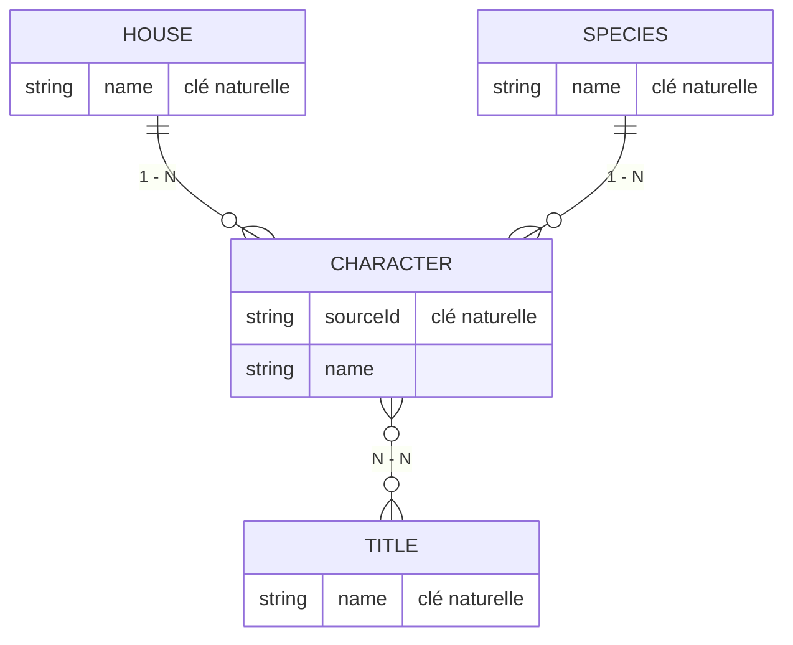

# HarryPotter 🧙

- Nous avons créé une API Harry Potter à partir de l'API PotterDB : https://docs.potterdb.com
- On a décidé de créer 4 entités : **Character** (personnage), **House** (maison), **Species** (espèce) et **Title** (titre).
- Une commande d'import récupère **50 personnages par maison** et les enregistre dans notre base.

**Duo :** Yasmine Meftah, Lorenzo L'Hostis

**Stack :** Symfony 8.1, API Platform 5, SQLite

## Schéma BDD



- **Character → House** : un personnage a une seule maison, une maison a plusieurs personnages
- **Character → Species** : un personnage a une seule espèce, une espèce a plusieurs personnages
- **Character → Title** : un personnage a plusieurs titres, un titre est porté par plusieurs personnages

**Clés naturelles :** `sourceId` pour Character (l'id PotterDB), `name` pour House, Species et Title.

## Installation (de zéro)

Il faut : PHP 8.4 ou plus (extensions `pdo_sqlite`, `sqlite3`, `intl`), Composer, Symfony CLI et Git.

```bash
git clone https://github.com/Lohos06/HarryPotter.git
cd HarryPotter
composer install
symfony console doctrine:migrations:migrate -n
symfony server:start -d
```

L'API est sur : http://127.0.0.1:8000/api

## Import

- **Source :** `https://api.potterdb.com/v1/characters?filter[house_eq]={maison}&page[size]=50`
- **Commande :**

```bash
symfony console app:import-characters gryffindor
symfony console app:import-characters slytherin
symfony console app:import-characters hufflepuff
symfony console app:import-characters ravenclaw
```

- Si on relance la commande, il n'y a pas de doublon (on vérifie le `sourceId`).
- **Mapping et règles de l'import :** dans le fichier [docs/mapping.xlsx](docs/mapping.xlsx) (onglets « Mapping des champs » et « Règles ETL »).

## Créer un personnage

`POST /api/characters`

```json
{
  "name": "Neville Longbottom",
  "gender": "male",
  "bloodStatus": "pure-blood",
  "born": "30 July 1980",
  "nationality": "English",
  "house": "Gryffindor",
  "species": "Human",
  "titles": ["Seeker", "Captain"]
}
```

On envoie directement le nom de la maison, de l'espèce et des titres : ils sont retrouvés en base, sinon créés

## Utilisation de l'IA

- **Claude** : installation de l'environnement, aide à la compréhension du fichier de mapping, écriture de certains bouts de code et aide au readme.
